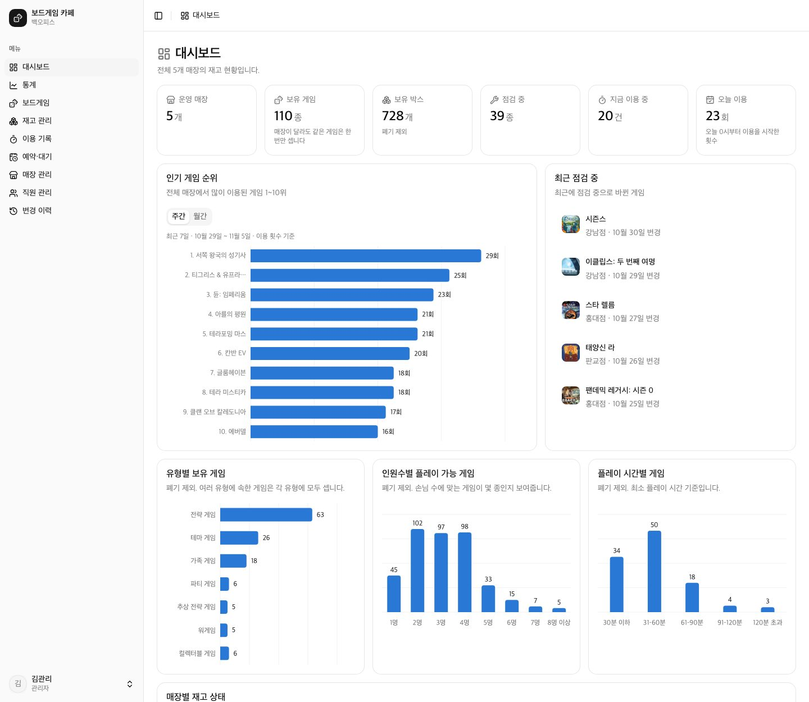
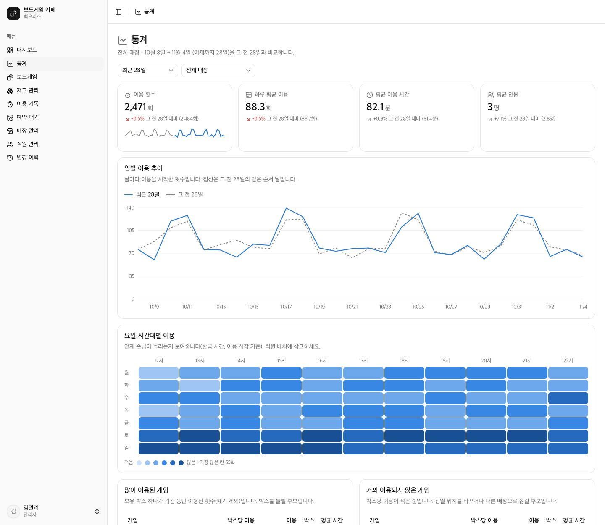
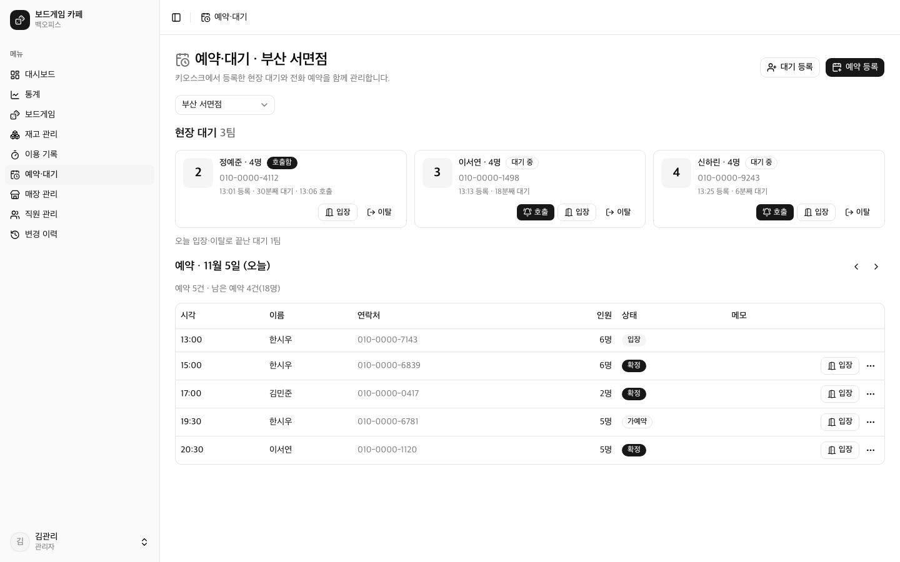
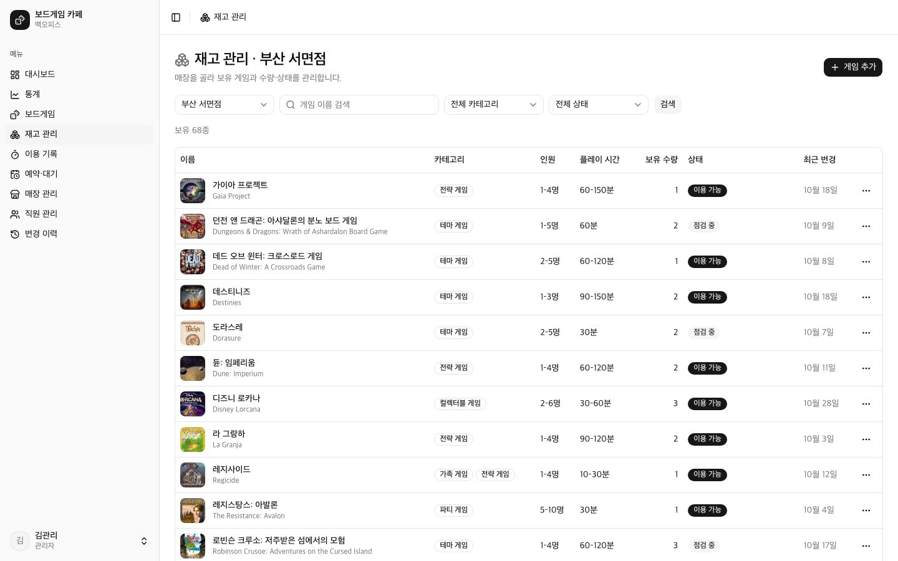
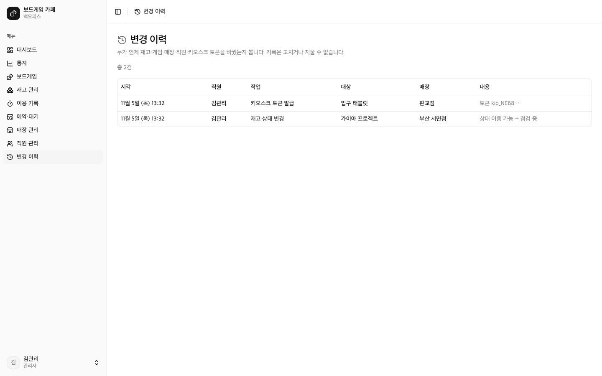
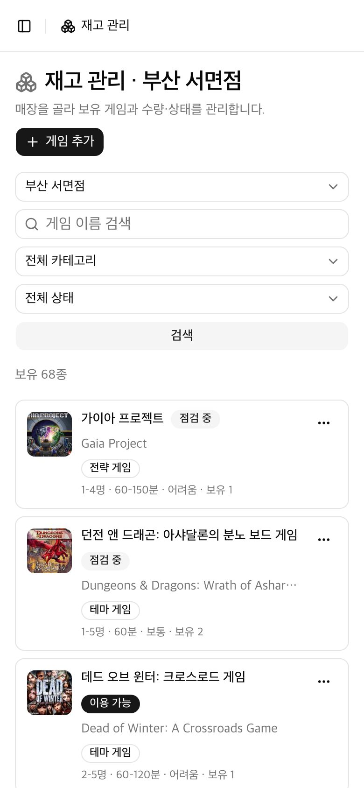
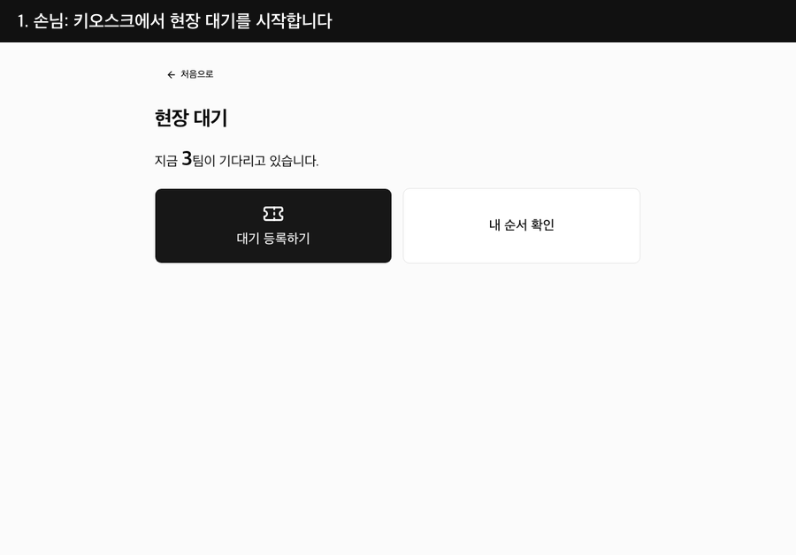
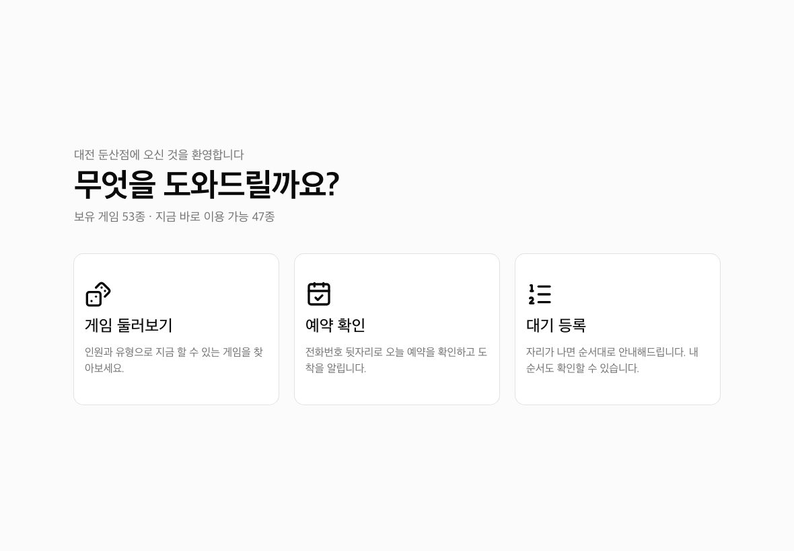
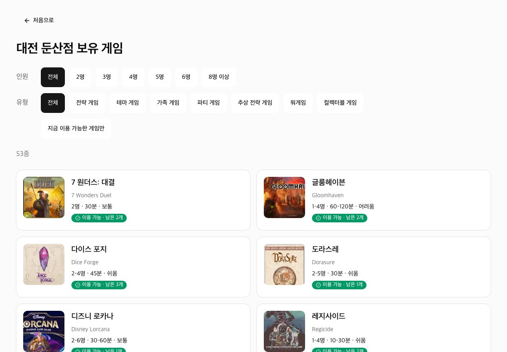
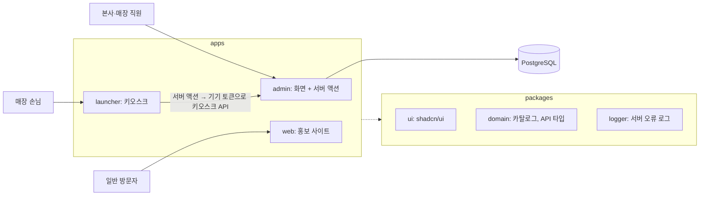

# 보드게임 카페 프랜차이즈 모노레포

[](https://github.com/ryushin01/avocado-monorepo/actions/workflows/ci.yml)

**[홍보 사이트 데모 보기](https://avocado-web-three.vercel.app/)** · 백오피스와 키오스크는 서버와 DB가 필요해 [로컬에서 실행](#시작하기)합니다.

> **프로젝트 상태:** 포트폴리오 프로젝트입니다. 데모는 홍보 사이트만 공개합니다. 실제로 운영하는 프랜차이즈가 아니며, 매장·직원·손님 데이터는 모두 가상입니다.

본사와 매장 직원이 쓰는 백오피스, 매장 손님이 쓰는 태블릿 키오스크, 일반 방문자가 보는 홍보 사이트를 한 저장소에서 관리합니다. 재고, 대여·반납, 예약, 현장 대기가 백오피스와 키오스크 사이에서 이어집니다.

| 앱 | 폴더 | 포트 | 쓰는 사람 | 내용 |
|---|---|---|---|---|
| 백오피스 | `apps/admin` | 3000 | 본사 관리자·매장 스태프 | 카탈로그, 매장 재고, 이용 기록(대여·반납), 예약·현장 대기, 매장·직원 관리, 대시보드, 통계, 변경 이력 |
| 가맹점 런처 | `apps/launcher` | 3001 | 매장 손님 (태블릿 키오스크) | 매장 보유 게임 둘러보기, 예약 확인·도착 알림, 현장 대기 등록·순서 확인 |
| 프랜차이즈 사이트 | `apps/web` | 3002 | 일반 방문자 | 게임 유형 소개, 유형별 목록, 게임 상세 |

## 화면

화면의 매장, 직원, 손님, 이용 기록은 모두 개발용 시드 데이터입니다.

### 백오피스

| 대시보드 | 통계 |
|---|---|
|  |  |

| 예약·현장 대기 | 재고 관리 |
|---|---|
|  |  |

| 변경 이력 | 모바일 재고 목록 |
|---|---|
|  |  |

### 현장 대기 흐름

손님이 키오스크에서 등록하면 백오피스에 바로 표시되고, 직원이 호출하면 손님이 키오스크에서 확인합니다.



### 키오스크와 홍보 사이트

| 키오스크 시작 | 키오스크 게임 둘러보기 |
|---|---|
|  |  |


## 아키텍처



- **세 앱을 각각 배포하고, 백오피스의 화면과 백엔드는 나누지 않습니다.** 판단 근거는 [docs/deployment.md](docs/deployment.md#배포-단위)에 있습니다.
- **런처는 DB에 직접 접근하지 않습니다.** 백오피스 주소와 토큰은 런처 서버에만 두고, 손님 화면은 서버 액션을 거쳐 API를 부릅니다.
- **화면 코드는 Feature-Sliced Design으로 나눕니다.** `app → views → widgets → features → entities → shared` 순서로만 가져오며, 어기면 `pnpm lint`가 실패합니다. 서버 코드는 FSD 밖 `src/server`, `src/db`에 둡니다.

## 기술 스택


| 영역 | 기술 | 이유 |
|---|---|---|
| 프레임워크 | Next.js 16 (App Router, Turbopack), React 19 (React Compiler) | 서버 컴포넌트와 서버 액션으로 API 층 없이 화면과 데이터를 연결합니다 |
| 언어 | TypeScript 7 (`tsc7`, 타입 검사), TypeScript 6 (`typescript ~6.0.3`, 도구) | `typescript-eslint`가 TS 7을 지원하지 않아 함께 씁니다. `typescript` 패키지를 7로 올리면 lint가 실패합니다. 백오피스 타입 검사가 약 3.9초에서 0.9초로 줄었습니다(1회 측정) |
| 구조 | Feature-Sliced Design, pnpm 12 workspaces, Turborepo | 세 앱이 UI, 도메인 타입, 설정을 공유하고, 화면 코드의 의존 방향을 lint로 강제합니다 |
| UI | shadcn/ui (Base UI), Tailwind CSS 4, lucide-react, Recharts, Embla Carousel, sonner | 컴포넌트를 저장소 안에서 직접 고칠 수 있습니다 |
| 데이터 | PostgreSQL, Drizzle ORM, PGlite | 개발과 테스트는 설치 없이 PGlite로 돌고, 운영은 `DATABASE_URL`로 PostgreSQL에 붙습니다 |
| 인증·검증 | Auth.js 4, zod 4 | 이메일·비밀번호 로그인과 서버 쪽 입력 검증을 씁니다 |
| 테스트 | Vitest 5, Testing Library, Playwright | 규칙은 단위 테스트로, 화면 흐름은 프로덕션 빌드 대상 E2E로 확인합니다 |
| 품질 | ESLint 9 (FSD 경계 규칙), GitHub Actions, CodeRabbit | PR마다 타입 검사, 린트, 테스트, 빌드, E2E를 돌리고 리뷰를 받습니다 |
| 배포 | Vercel(홍보 사이트) | `main`에 머지하면 자동 배포되고, PR마다 미리보기 주소가 생깁니다 |

## 설계에서 신경 쓴 점

- **권한은 서버에서 다시 확인합니다.** 버튼을 숨기는 것과 별개로 모든 서버 액션이 권한을 확인하고, 스태프가 주소에 다른 매장을 넣어도 소속 매장만 보입니다.
- **동시성:** 마지막 박스 대여와 대기 번호 발급은 트랜잭션 안에서 해당 줄을 잠근 뒤 확인합니다.
- **손님 개인정보:** 키오스크 응답에는 전화번호를 넣지 않고 이름을 가립니다(김\*수). DB 오류 메시지에 들어간 쿼리 값도 로그에서 가리며, 실제 DB 오류로 이를 검증합니다.
- **키오스크 보안:** 기기마다 토큰을 발급하고 해시만 저장하며, 다른 매장의 주소에는 쓸 수 없습니다. 손님 조회는 기기별로 분당 30번까지만 받습니다.
- **변경 이력:** 재고, 게임, 매장, 직원, 키오스크 토큰 변경을 누가 언제 했는지 남깁니다. 비밀번호와 토큰 원문은 남기지 않습니다.
- **번들 관리:** zod 스키마를 별도 진입점으로 나눠 브라우저 번들에 들어가지 않게 했습니다.
- **접근성:** 색만으로 구분하지 않고, 차트에 같은 데이터의 표를 함께 둡니다. 히트맵과 사이드바 너비 조절은 키보드로도 쓸 수 있습니다.

## 개발 방식

포트폴리오 목적으로 만든 프로젝트입니다. 구현과 문서 작성에 AI 코딩 도구 [Claude Code](https://claude.com/claude-code)를 사용했고, PR 리뷰에는 CodeRabbit을 씁니다. Claude Code로 만든 커밋에는 `Co-Authored-By` 표시가 있고, 작업 규칙은 [AGENTS.md](AGENTS.md)와 [docs/conventions.md](docs/conventions.md)에 있습니다.

## 알려진 한계

- **변경 이력은 변경과 한 트랜잭션이 아닙니다.** 기록에 실패하면 변경은 유지되고 오류 로그만 남으므로 한 건이 빠질 수 있습니다.
- **CSP의 `script-src`에 `unsafe-inline`이 남아 있습니다.** nonce 방식은 Partial Prefetching과 함께 쓸 수 없어 인라인 스크립트 삽입까지는 막지 못합니다.
- **외부 오류 모니터링이 없습니다.** 서버 오류는 프로세스 로그로만 남습니다.
- **React Compiler의 렌더링 개선 효과는 측정하지 않았습니다.** 클라이언트 번들은 백오피스 기준 약 7% 늘었습니다(1회 측정).

저장소: [github.com/ryushin01/avocado-monorepo](https://github.com/ryushin01/avocado-monorepo). 원래 avocado 프로젝트(`ryushin01/avocado`)와는 별도 저장소입니다.

> 백오피스 데이터는 PostgreSQL(Drizzle)에 저장합니다. 개발할 때는 설치 없이 Node 안에서 도는 PGlite를 쓰고(`apps/admin/.data`), 운영에서는 `DATABASE_URL`로 PostgreSQL에 붙습니다. 백오피스는 로그인(Auth.js 4, 이메일·비밀번호)이 필요하고, 개발용 계정은 [apps/admin/README.md](apps/admin/README.md)에 있습니다. 런처는 백오피스의 키오스크 API를 읽으므로 백오피스가 켜져 있어야 합니다.

## 시작하기

Node.js 24 이상과 pnpm 12가 필요합니다(CI는 Node 24). 명령은 모두 저장소 루트에서 실행합니다.

pnpm 버전은 루트 `package.json`의 `packageManager`(`pnpm@12.16.1`)로 고정되어 있습니다. `pnpm -v`가 12보다 낮으면 먼저 올려 주세요. pnpm 9는 이 버전으로 자동 전환하지 않습니다.

```bash
npm install -g pnpm@12.16.1
```

```bash
pnpm install
pnpm exec playwright install chromium   # E2E 테스트를 돌릴 때만

pnpm dev                          # 세 앱을 모두 띄움 (DB 설치 불필요, 처음 실행 때 시드 데이터를 넣음)
pnpm dev:admin               # 백오피스만
pnpm dev:launcher                 # 런처 + 런처가 읽는 백오피스
pnpm dev:web                     # 홍보 사이트만
```

띄운 뒤에는 아래 주소로 들어갑니다. 백오피스는 `admin@example.com` / `avocado1234`로 로그인합니다(스태프 계정은 [apps/admin/README.md](apps/admin/README.md)).

| 앱 | 주소 |
|---|---|
| 백오피스 | http://localhost:3000 |
| 키오스크 | http://localhost:3001 |
| 홍보 사이트 | http://localhost:3002 |

특정 앱·패키지에서만 실행할 때는 `--filter`를 씁니다. 예: `pnpm --filter @avocado/admin test`

의존성을 추가할 때도 그것을 쓰는 앱·패키지에 추가합니다. 예: `pnpm --filter @avocado/web add <패키지>`. pnpm은 각 패키지가 `package.json`에 선언한 의존성만 가져올 수 있게 하므로, 루트에 설치돼 있다고 다른 곳에서 쓸 수 있는 것이 아닙니다. 내부 패키지는 `"workspace:*"`로 연결합니다.

pnpm 12는 공개된 지 하루가 안 된 패키지 버전을 설치하지 않습니다(`minimumReleaseAge`, 공급망 공격 대비). 의존성 범위에 맞는 더 오래된 버전이 없을 때만 pnpm이 그 버전을 `pnpm-workspace.yaml`의 `minimumReleaseAgeExclude`에 적습니다. 하루가 지나면 그 항목은 지워도 됩니다.

### 런처 설정

런처는 매장마다 환경 변수로 어느 백오피스·매장을 볼지 정합니다(`apps/launcher/.env.example`).

| 변수 | 기본값 | 설명 |
|---|---|---|
| `BACKOFFICE_URL` | `http://localhost:3000` | 백오피스 주소 |
| `LAUNCHER_CAFE_ID` | `c_gangnam` | 이 키오스크가 놓인 매장 |
| `KIOSK_API_TOKEN` | `kio_dev_c_gangnam` (예시) | 이 기기의 키오스크 토큰. 백오피스 매장 관리 > 키오스크 토큰에서 매장·기기마다 발급합니다. 운영에서는 필수, 개발 DB에는 매장마다 `kio_dev_<매장 id>`가 있습니다 |

## 스크립트

| 명령 | 설명 |
|---|---|
| `pnpm build` | 모든 앱 프로덕션 빌드 |
| `pnpm typecheck` | 모든 앱·패키지 타입 검사 |
| `pnpm lint` | ESLint |
| `pnpm test` | 단위·컴포넌트 테스트 (Vitest) |
| `pnpm test:coverage` | 단위 테스트 + 커버리지 (앱마다 `coverage/`) |
| `pnpm e2e` | E2E 테스트 (백오피스, 키오스크용 런처, 홈페이지를 함께 띄움) |
| `pnpm import:avocado-images` | avocado 데이터의 게임 이미지를 내려받아 128px webp 썸네일 생성 (`packages/domain/assets`). 있는 파일은 건너뜀 |
| `pnpm import:avocado` | avocado 데이터로 카탈로그 다시 생성 (`packages/domain/data/catalog.json`) |
| `pnpm import:avocado-media` | avocado 사진·아이콘을 홍보 사이트용 webp로 다시 생성 (`apps/web/public/images`) |

푸시와 PR마다 GitHub Actions가 검사를 모두 실행합니다(`.github/workflows/ci.yml`). PR 리뷰는 CodeRabbit이 합니다(`.coderabbit.yaml`, GitHub에 앱 설치 필요).

avocado 데이터가 바뀌면 `import:avocado-images` → `import:avocado` 순서로 실행합니다. 둘 다 기본으로 이 저장소 옆의 `../avocado-master`를 읽고, 다른 위치라면 경로를 인자로 넘기세요.

```bash
pnpm import:avocado-images /path/to/avocado
pnpm import:avocado /path/to/avocado/public/data
pnpm import:avocado-media /path/to/avocado   # 홍보 사이트 사진
```

카탈로그 이미지는 `packages/domain/assets`에만 커밋합니다. 각 앱의 `dev`·`build` 스크립트가 맨 앞에서 자기 `public/images`로 복사합니다(복사본은 git 제외).

## 폴더 구조

```
apps/
├─ admin/        백오피스 (README.md, docs/architecture.md)
├─ launcher/     가맹점 런처 (손님용 키오스크)
└─ web/          프랜차이즈 홈페이지
packages/
├─ ui/           shadcn/ui 컴포넌트와 테마
├─ domain/       카탈로그 데이터·썸네일, 공통 타입, avocado 변환 스크립트
├─ logger/       서버 오류 로그
└─ config/       tsconfig, ESLint
docs/
├─ conventions.md  모든 앱 공통 작성 규칙
├─ deployment.md   배포한다면 확인할 것
└─ images/         README 화면 캡처
```

## 문서

- [apps/admin/README.md](apps/admin/README.md): 백오피스 기능, 개발용 계정
- [apps/admin/docs/architecture.md](apps/admin/docs/architecture.md): 도메인 모델, 권한, 키오스크 API, Next.js 16 렌더링 규칙
- [apps/launcher/README.md](apps/launcher/README.md), [apps/web/README.md](apps/web/README.md)
- [docs/conventions.md](docs/conventions.md): 코드 구조(FSD)·UI·폼·테스트 규칙과 알려진 함정
- [docs/deployment.md](docs/deployment.md): 배포한다면 확인할 것 (환경 변수, 첫 관리자 만들기, 마이그레이션, 보안)

## 아직 하지 않은 것

- 배포와 CD: 지금은 로컬에서만 실행합니다. 배포한다면 확인할 것은 `docs/deployment.md`에 있습니다
- 외부 오류 모니터링과 알림 (지금은 표준 오류 로그까지, 붙일 곳은 각 앱의 `src/instrumentation.ts`)
- 예약: 손님이 직접 하는 온라인 예약, 정원·테이블 배정, 문자 알림(대기 호출 등)
- ESLint 10: eslint-config-next가 쓰는 React·import·접근성 플러그인이 아직 9까지만 지원해서 9에 머물러 있습니다
