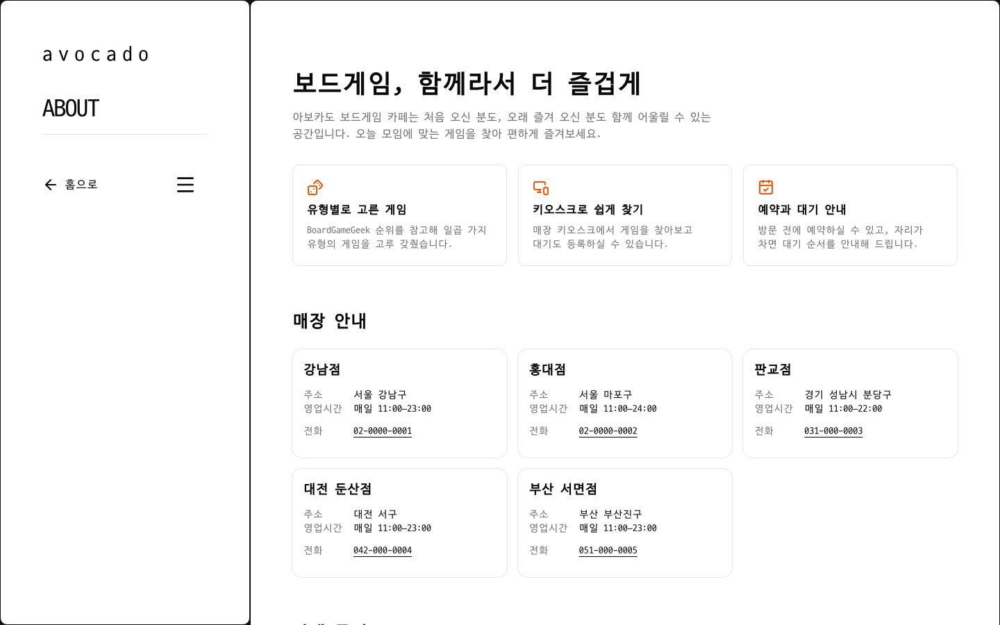
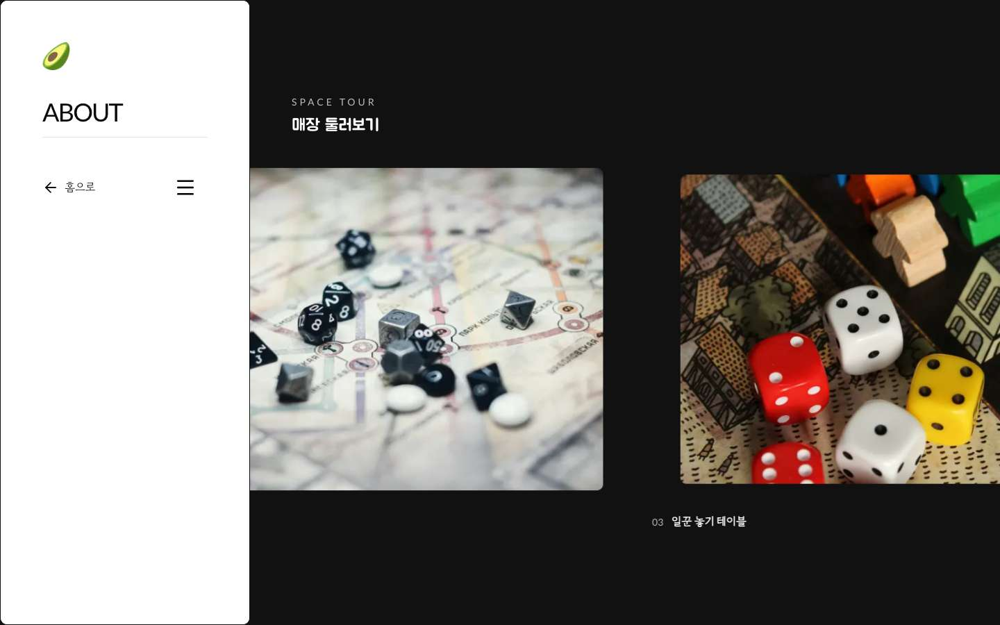

# 보드게임 카페 프랜차이즈 모노레포

[](https://github.com/ryushin01/avocado-monorepo/actions/workflows/ci.yml)

**[홍보 사이트 데모 보기](https://avocado-web-ryushin01.vercel.app/)** · 백오피스와 키오스크는 서버와 DB가 필요해 [로컬에서 실행](#시작하기)합니다.

> **프로젝트 상태:** 포트폴리오 프로젝트입니다. 데모는 홍보 사이트만 공개합니다. 실제로 운영하는 프랜차이즈가 아니며, 매장·직원·손님 데이터는 모두 가상입니다.

본사와 매장 직원이 쓰는 백오피스, 매장 손님이 쓰는 태블릿 키오스크, 일반 방문자가 보는 홍보 사이트를 한 저장소에서 관리합니다. 재고, 대여·반납, 예약, 현장 대기가 백오피스와 키오스크 사이에서 이어집니다.

| 앱 | 폴더 | 포트 | 쓰는 사람 | 내용 |
|---|---|---|---|---|
| 백오피스 | `apps/admin` | 3000 | 본사 관리자·매장 스태프 | 카탈로그, 매장 재고, 이용 기록(대여·반납), 예약·현장 대기, 매장·직원 관리, 대시보드, 통계, 변경 이력 |
| 가맹점 런처 | `apps/launcher` | 3001 | 매장 손님 (태블릿 키오스크) | 매장 보유 게임 둘러보기, 예약 확인·도착 알림, 현장 대기 등록·순서 확인 |
| 프랜차이즈 사이트 | `apps/web` | 3002 | 일반 방문자 | 게임 유형 소개, 유형별 목록, 게임 상세, 브랜드·매장 소개, 공간 스크롤 연출 |

## 화면

화면의 매장, 직원, 손님, 이용 기록은 모두 개발용 시드 데이터입니다.

### 백오피스

| 대시보드 | 통계 |
|---|---|
|  |  |

| 예약·현장 대기 | 재고 관리 |
|---|---|
|  |  |

| 변경 이력 | 모바일 재고 목록 |
|---|---|
|  |  |

### 현장 대기 흐름

손님이 키오스크에서 등록하면 백오피스에 바로 표시되고, 직원이 호출하면 손님이 키오스크에서 확인합니다.


### 키오스크와 홍보 사이트

| 키오스크 시작 | 키오스크 게임 둘러보기 |
|---|---|
|  |  |

| 홍보 사이트 홈 | 브랜드 소개 |
|---|---|
|  |  |

| 홈 유형 사진 (스크롤로 펼쳐짐) | 매장 둘러보기 (스크롤로 옆으로 이동) |
|---|---|
|  |  |

## 주요 기능

- **백오피스:** 카탈로그, 매장 재고, 대여·반납, 예약과 현장 대기, 매장·직원 관리, 대시보드, 통계, 변경 이력
- **키오스크:** 매장 보유 게임 둘러보기, 예약 확인과 도착 알림, 현장 대기 등록과 순서 확인
- **홍보 사이트:** 게임 유형 소개, 유형별 목록, 게임 상세, 브랜드·매장 소개. 홈 유형 사진은 스크롤하면 화면 가득 펼쳐지고, 소개 화면의 매장 둘러보기는 화면을 고정한 채 옆으로 걸어가듯 넘어갑니다(CSS 스크롤 타임라인)
- **권한과 개인정보:** 모든 서버 액션에서 권한 재확인, 손님 이름 가림, 기기별 키오스크 토큰
- **접근성:** 본문 바로가기, 키보드로 쓰는 히트맵과 사이드바, 색에 의존하지 않는 표시

## 기술 스택


| 영역 | 기술 | 이유 |
|---|---|---|
| 프레임워크 | Next.js 16 (App Router, Turbopack), React 19 (React Compiler) | 서버 컴포넌트와 서버 액션으로 API 층 없이 화면과 데이터를 연결합니다 |
| 언어 | TypeScript 7 (`tsc7`, 타입 검사), TypeScript 6 (`typescript ~6.0.3`, 도구) | `typescript-eslint`가 TS 7을 지원하지 않아 함께 씁니다. `typescript` 패키지를 7로 올리면 lint가 실패합니다. 백오피스 타입 검사가 약 3.9초에서 0.9초로 줄었습니다(1회 측정) |
| 구조 | Feature-Sliced Design, pnpm 12 workspaces, Turborepo | 세 앱이 UI, 도메인 타입, 설정을 공유하고, 화면 코드의 의존 방향을 lint로 강제합니다 |
| UI | shadcn/ui (Base UI), Tailwind CSS 4, lucide-react, Recharts, Embla Carousel, sonner, TanStack Table, TanStack Virtual | 컴포넌트를 저장소 안에서 직접 고칠 수 있습니다 |
| 데이터 | PostgreSQL, Drizzle ORM, PGlite | 개발과 테스트는 설치 없이 PGlite로 돌고, 운영은 `DATABASE_URL`로 PostgreSQL에 붙습니다 |
| 인증·검증 | Auth.js 4, zod 4 | 이메일·비밀번호 로그인과 서버 쪽 입력 검증을 씁니다 |
| 테스트 | Vitest 5, Testing Library, Playwright | 규칙은 단위 테스트로, 화면 흐름은 프로덕션 빌드 대상 E2E로 확인합니다 |
| 품질 | ESLint 9 (FSD 경계 규칙, jsx-a11y), GitHub Actions, CodeRabbit | PR마다 타입 검사, 린트, 테스트, 빌드, E2E를 돌리고 리뷰를 받습니다 |
| 성능 예산 | size-limit, Lighthouse CI(홍보 사이트) | 번들 크기와 Lighthouse 점수가 기준 아래로 떨어지면 PR을 막습니다 |
| 배포 | Vercel(홍보 사이트) | `main`에 머지하면 자동 배포됩니다(PR 미리보기 배포는 껐음) |
| 모니터링 | Sentry(홍보 사이트) | 브라우저와 서버 오류를 모읍니다. 개인정보는 모으지 않고, DSN이 없으면 동작하지 않습니다 |
| 분석 | PostHog, Web Vitals(홍보 사이트) | 실제 방문자의 LCP·INP·CLS와 페이지 이동을 모읍니다. 쿠키 없이 사람을 식별하지 않고, 키가 없으면 동작하지 않습니다 |

## 시작하기

Node.js 24 이상과 pnpm 12가 필요합니다. 명령은 모두 저장소 루트에서 실행합니다.

```bash
pnpm install
pnpm exec playwright install chromium   # E2E 테스트를 돌릴 때만
pnpm dev                                # 세 앱을 모두 띄움 (DB 설치 불필요)
```

| 앱 | 주소 |
|---|---|
| 백오피스 | http://localhost:3000 (`admin@example.com` / `avocado1234`) |
| 키오스크 | http://localhost:3001 |
| 홍보 사이트 | http://localhost:3002 |

| 명령 | 설명 |
|---|---|
| `pnpm build` | 모든 앱 프로덕션 빌드 |
| `pnpm typecheck` | 타입 검사 |
| `pnpm lint` | ESLint |
| `pnpm test` | 단위·컴포넌트 테스트 |
| `pnpm e2e` | E2E 테스트 |
| `pnpm --filter @avocado/web size` / `lhci` | 홍보 사이트 번들 크기 / Lighthouse 기준 검사 (먼저 빌드 필요) |

## 프로젝트 구조

```
apps/
├─ admin/        백오피스 (README.md, docs/architecture.md)
├─ launcher/     가맹점 런처 (손님용 키오스크)
└─ web/          프랜차이즈 홈페이지
packages/
├─ ui/           shadcn/ui 컴포넌트와 테마
├─ domain/       카탈로그 데이터·썸네일, 공통 타입, avocado 변환 스크립트
├─ logger/       서버 오류 로그
└─ config/       tsconfig, ESLint
docs/
├─ design.md       설계와 한계
├─ development.md  개발 가이드
├─ conventions.md  모든 앱 공통 작성 규칙
├─ deployment.md   배포한다면 확인할 것
└─ images/         README 화면 캡처
```

## 문서

| 문서 | 내용 |
|---|---|
| [설계와 한계](docs/design.md) | 아키텍처, 설계 판단, 알려진 한계, 범위 밖의 일 |
| [개발 가이드](docs/development.md) | pnpm, 런처 설정, 스크립트 전체, 데이터 가져오기 |
| [코드 규칙](docs/conventions.md) | FSD, UI, 폼, 테스트 규칙과 알려진 함정 |
| [배포](docs/deployment.md) | 환경 변수, 첫 관리자 만들기, 마이그레이션, 보안 |
| [백오피스](apps/admin/README.md) | 기능, 개발용 계정 |
| [백오피스 구조](apps/admin/docs/architecture.md) | 도메인 모델, 권한, 키오스크 API, 렌더링 규칙 |
| [런처](apps/launcher/README.md), [홍보 사이트](apps/web/README.md) | 앱별 안내 |
| [시퀀스 다이어그램](docs/sequence-diagrams.md) | 키오스크 예약 확인·도착 알림, 현장 대기 등록, 대여와 반납 |

## 출처

| 자료 | 저작자 | 사용 허락 | 원본 |
|---|---|---|---|
| Geist · Geist Mono 글꼴 | The Geist Project Authors(Vercel) | SIL OFL 1.1 | [vercel/geist-font](https://github.com/vercel/geist-font) |
| Gowun Dodum(고운돋움) 글꼴 | The Gowun Dodum Project Authors(류양희) | SIL OFL 1.1 | [yangheeryu/Gowun-Dodum](https://github.com/yangheeryu/Gowun-Dodum) |
| Jua(주아) 글꼴 | The BM JUA Project Authors(우아한형제들) | SIL OFL 1.1 | [Google Fonts](https://fonts.google.com/specimen/Jua) |
| Lato 글꼴 | Łukasz Dziedzic(tyPoland) | SIL OFL 1.1 | [Google Fonts](https://fonts.google.com/specimen/Lato) |
| Sunflower 글꼴 | The Sunflower Project Authors | SIL OFL 1.1 | [Google Fonts](https://fonts.google.com/specimen/Sunflower) |
| 아보카도 아이콘 (세 앱의 파비콘·로고, 키오스크 앱 아이콘) | Google (Noto Emoji) | Apache 2.0 ([사본](apps/web/public/brand/LICENSE-noto-emoji.txt), 앱마다 `public/brand`에 같은 사본) | [googlefonts/noto-emoji](https://github.com/googlefonts/noto-emoji) |
| 보드게임 상자 그림(게임 썸네일) | 각 게임의 출판사 | 확인 안 됨 (저작권은 출판사에 있고, 사용 허락을 받지 않은 포트폴리오용 썸네일) | [BoardGameGeek](https://boardgamegeek.com) (avocado 데이터의 게임별 `bggId`) |

홍보 사이트의 사진·아이콘은 원작 avocado 프로젝트의 자료를 줄여 옮겼고(`pnpm import:avocado-media`), 매장·직원·손님 데이터는 가상 데이터입니다.
