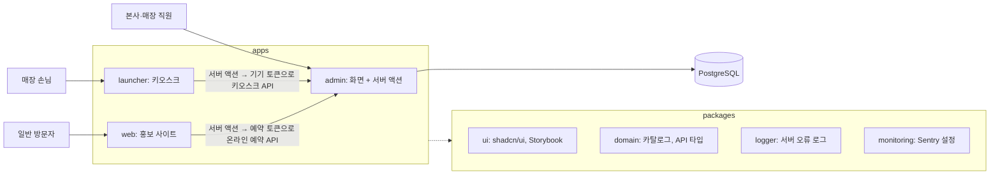

# 설계와 한계

## 아키텍처

- **세 앱을 각각 배포하고, 백오피스의 화면과 백엔드는 나누지 않습니다.** 판단 근거는 [docs/deployment.md](deployment.md#배포-단위)에 있습니다.
- **런처와 홍보 사이트는 DB에 직접 접근하지 않습니다.** 백오피스 주소와 토큰은 각 앱의 서버에만 두고, 손님 화면은 서버 액션을 거쳐 키오스크 API·온라인 예약 API를 부릅니다. 브라우저는 백오피스 주소를 모르고 CORS도 열지 않습니다.
- **화면 코드는 Feature-Sliced Design으로 나눕니다.** `_app → _pages → widgets → features → entities → shared` 순서로만 가져오며, 어기면 `pnpm lint`(ESLint·Steiger)가 실패합니다. 한 화면에서만 쓰는 코드는 그 화면 슬라이스에 둡니다. 서버 코드는 FSD 밖 `src/server`, `src/db`에 둡니다.

## 설계에서 신경 쓴 점

- **권한은 서버에서 다시 확인합니다.** 버튼을 숨기는 것과 별개로 모든 서버 액션이 권한을 확인하고, 스태프가 주소에 다른 매장을 넣어도 소속 매장만 보입니다.
- **동시성:** 마지막 박스 대여, 재고 수정·제외, 대기 번호 발급은 트랜잭션 안에서 해당 줄을 잠근 뒤 확인하고, 예약·대기 상태 변경은 읽은 상태가 그대로일 때만 씁니다. 예약·게임·매장·직원·재고의 편집 폼은 창을 연 시점의 행 버전으로 저장해(낙관적 잠금), 그사이 다른 직원이 고친 내용을 덮어쓰지 않습니다. 예약의 테이블 배정(직원 등록·온라인 예약)과 테이블 추가는 매장 줄을 잠근 트랜잭션에서 해, 같은 테이블을 두 예약에 주거나 같은 이름의 테이블이 둘 생기지 않습니다. 로그인 실패도 쿼리 하나로 세어 동시에 보낸 요청으로 잠금을 피하지 못합니다.
- **실시간 반영:** 카운터에 열어 둔 예약·대기 화면은 15초마다 다시 받아, 손님이 키오스크에서 등록한 대기와 도착 알림이 새로고침 없이 보입니다. 키오스크 시작 화면의 이용 가능 수도 1분마다 다시 받습니다.
- **손님 개인정보:** 키오스크 응답에는 전화번호를 넣지 않고 이름을 가립니다(김\*수). DB 오류 메시지에 들어간 쿼리 값도 로그에서 가리며, 실제 DB 오류로 이를 검증합니다.
- **키오스크 보안:** 기기마다 토큰을 발급하고 해시만 저장하며, 다른 매장의 주소에는 쓸 수 없습니다. 손님 조회는 기기별로 분당 30번까지만 받습니다.
- **온라인 예약:** 홍보 사이트 서버만 토큰으로 예약 API를 부르고, 방문자 접속 주소는 HMAC으로만 넘겨 방문자마다 요청 수를 셉니다. 응답을 받지 못한 손님이 같은 내용(번호·매장·시각·인원)을 다시 보내면 새로 만들지 않고 이미 된 예약을 돌려줍니다. 개인정보 동의를 받고, 예약은 방문 예정 시각, 현장 대기는 등록 시각으로부터 90일이 지나면 지웁니다.
- **변경 이력:** 재고, 게임, 매장, 직원, 키오스크 토큰 변경을 누가 언제 했는지 남깁니다. 비밀번호와 토큰 원문은 남기지 않습니다.
- **번들 관리:** zod 스키마를 별도 진입점으로 나눠 브라우저 번들에 들어가지 않게 했습니다.
- **접근성:** 백오피스·키오스크 화면과 온라인 예약은 E2E에서 axe로, 홍보 사이트는 Lighthouse로, 공통 UI 부품은 Storybook 스토리마다(열린 상태 포함) axe로 검사합니다. 알림 영역은 처음부터 두고 내용만 바꿉니다. 색만으로 구분하지 않고, 차트에 같은 데이터의 표를 함께 둡니다. 히트맵과 사이드바 너비 조절은 키보드로도 쓸 수 있습니다. 세 앱 모두 본문 바로가기가 있고, 표 정렬 상태는 `aria-sort`로, 가상화한 목록의 전체 개수와 위치는 `aria-setsize`와 `aria-posinset`으로 알립니다.
- **긴 목록:** 보드게임 표는 전체 목록 기준으로 서버가 정렬하고 상태를 URL에 둡니다(TanStack Table). 모바일 무한 스크롤은 화면 근처만 그립니다(TanStack Virtual).

## 개발 방식

포트폴리오 목적으로 만든 프로젝트입니다. 구현과 문서 작성에 AI 코딩 도구 [Claude Code](https://claude.com/claude-code)를 사용했고, PR 리뷰에는 CodeRabbit을 씁니다. Claude Code로 만든 커밋에는 `Co-Authored-By` 표시가 있고, 작업 규칙은 [AGENTS.md](../AGENTS.md)와 [docs/conventions.md](conventions.md)에 있습니다.

## 알려진 한계

- **변경 이력은 변경과 한 트랜잭션이 아닙니다.** 기록에 실패하면 변경은 유지되고 오류 로그만 남으므로 한 건이 빠질 수 있습니다.
- **CSP의 `script-src`에 `unsafe-inline`이 남아 있습니다.** nonce 방식은 Partial Prefetching과 함께 쓸 수 없어 인라인 스크립트 삽입까지는 막지 못합니다.
- **오류 모니터링은 DSN을 넣어야 동작합니다.** 세 앱 모두 `NEXT_PUBLIC_SENTRY_DSN`이 있을 때만 Sentry로 보내고(`packages/monitoring`), 같은 로그 이벤트는 10분에 한 번만 보내 양을 줄입니다. 이벤트 종류마다 따로 세므로 무료 요금제(월 5천 건)를 보장하지는 않아, 한도는 Sentry 쪽 설정으로 지킵니다. 알림 규칙은 Sentry에서 정합니다.
- **방문 통계는 쿠키 없이 모으므로 재방문을 구분하지 않습니다.** 홍보 사이트의 PostHog는 메모리에만 식별자를 두어 새로 고치면 다른 방문으로 셉니다. 정확한 방문자 수보다 Web Vitals 분포를 보는 용도입니다.
- **React Compiler의 렌더링 개선 효과는 측정하지 않았습니다.** 클라이언트 번들은 백오피스 기준 약 7% 늘었습니다(1회 측정).
- **온라인 예약은 단순한 규칙만 씁니다.** 예약 하나가 테이블 하나를 2시간 쓰고(큰 일행을 위해 테이블을 합치지 않아 온라인은 8명까지), 현장 대기와 예약 없이 앉은 손님은 테이블 점유에 세지 않습니다(직원이 화면을 보고 정함). 받는 시각은 매장마다 다른 마감과 관계없이 12~20시입니다. 변경·취소는 매장 전화로만 하고, 예약 확인 문자는 보내지 않습니다.
- **홍보 사이트 JS 예산(450 kB, gzip)의 여유가 적습니다.** main 기준 446 kB이고, 의존성을 올리면 넘을 수 있습니다(늘어나는 것은 첫 화면 뒤 따로 받는 PostHog·Sentry가 대부분).

## 지금 범위에 넣지 않은 것

- 실제 운영 배포: 세 앱이 Vercel에 공개 데모로 떠 있지만([docs/demo.md](demo.md), 메모리 DB 30분마다 초기화), 관리형 PostgreSQL·비밀 값·도메인을 갖춘 운영 배포는 하지 않았습니다. 확인할 것은 `docs/deployment.md`에 있습니다
- 예약: 문자 알림(대기 호출, 예약 확인), 온라인 예약의 변경·취소, 예약금
- ESLint 10: eslint-config-next가 쓰는 React·import·접근성 플러그인이 아직 9까지만 지원해서 9에 머물러 있습니다

## 저장소와 데이터

저장소: [github.com/ryushin01/avocado-monorepo](https://github.com/ryushin01/avocado-monorepo). 원래 avocado 프로젝트(`ryushin01/avocado`)와는 별도 저장소입니다.

> 백오피스 데이터는 PostgreSQL(Drizzle)에 저장합니다. 개발할 때는 설치 없이 Node 안에서 도는 PGlite를 쓰고(`apps/admin/.data`), 운영에서는 `DATABASE_URL`로 PostgreSQL에 붙습니다. 백오피스는 로그인(Auth.js 4, 이메일·비밀번호)이 필요하고, 개발용 계정은 [apps/admin/README.md](../apps/admin/README.md)에 있습니다. 런처는 백오피스의 키오스크 API를 읽으므로 백오피스가 켜져 있어야 합니다.
