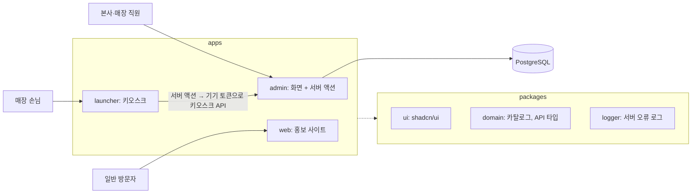

# 설계와 한계

## 아키텍처

- **세 앱을 각각 배포하고, 백오피스의 화면과 백엔드는 나누지 않습니다.** 판단 근거는 [docs/deployment.md](deployment.md#배포-단위)에 있습니다.
- **런처는 DB에 직접 접근하지 않습니다.** 백오피스 주소와 토큰은 런처 서버에만 두고, 손님 화면은 서버 액션을 거쳐 API를 부릅니다.
- **화면 코드는 Feature-Sliced Design으로 나눕니다.** `app → views → widgets → features → entities → shared` 순서로만 가져오며, 어기면 `pnpm lint`가 실패합니다. 서버 코드는 FSD 밖 `src/server`, `src/db`에 둡니다.

## 설계에서 신경 쓴 점

- **권한은 서버에서 다시 확인합니다.** 버튼을 숨기는 것과 별개로 모든 서버 액션이 권한을 확인하고, 스태프가 주소에 다른 매장을 넣어도 소속 매장만 보입니다.
- **동시성:** 마지막 박스 대여와 대기 번호 발급은 트랜잭션 안에서 해당 줄을 잠근 뒤 확인합니다.
- **손님 개인정보:** 키오스크 응답에는 전화번호를 넣지 않고 이름을 가립니다(김\*수). DB 오류 메시지에 들어간 쿼리 값도 로그에서 가리며, 실제 DB 오류로 이를 검증합니다.
- **키오스크 보안:** 기기마다 토큰을 발급하고 해시만 저장하며, 다른 매장의 주소에는 쓸 수 없습니다. 손님 조회는 기기별로 분당 30번까지만 받습니다.
- **변경 이력:** 재고, 게임, 매장, 직원, 키오스크 토큰 변경을 누가 언제 했는지 남깁니다. 비밀번호와 토큰 원문은 남기지 않습니다.
- **번들 관리:** zod 스키마를 별도 진입점으로 나눠 브라우저 번들에 들어가지 않게 했습니다.
- **접근성:** 색만으로 구분하지 않고, 차트에 같은 데이터의 표를 함께 둡니다. 히트맵과 사이드바 너비 조절은 키보드로도 쓸 수 있습니다. 세 앱 모두 본문 바로가기가 있고, 표 정렬 상태는 `aria-sort`로, 가상화한 목록의 전체 개수와 위치는 `aria-setsize`와 `aria-posinset`으로 알립니다.
- **긴 목록:** 보드게임 표는 전체 목록 기준으로 서버가 정렬하고 상태를 URL에 둡니다(TanStack Table). 모바일 무한 스크롤은 화면 근처만 그립니다(TanStack Virtual).

## 개발 방식

포트폴리오 목적으로 만든 프로젝트입니다. 구현과 문서 작성에 AI 코딩 도구 [Claude Code](https://claude.com/claude-code)를 사용했고, PR 리뷰에는 CodeRabbit을 씁니다. Claude Code로 만든 커밋에는 `Co-Authored-By` 표시가 있고, 작업 규칙은 [AGENTS.md](../AGENTS.md)와 [docs/conventions.md](conventions.md)에 있습니다.

## 알려진 한계

- **변경 이력은 변경과 한 트랜잭션이 아닙니다.** 기록에 실패하면 변경은 유지되고 오류 로그만 남으므로 한 건이 빠질 수 있습니다.
- **CSP의 `script-src`에 `unsafe-inline`이 남아 있습니다.** nonce 방식은 Partial Prefetching과 함께 쓸 수 없어 인라인 스크립트 삽입까지는 막지 못합니다.
- **외부 오류 모니터링은 홍보 사이트에만 있습니다.** 홍보 사이트는 DSN을 넣으면 Sentry로 오류를 보냅니다. 백오피스와 런처의 서버 오류는 프로세스 로그로만 남습니다.
- **React Compiler의 렌더링 개선 효과는 측정하지 않았습니다.** 클라이언트 번들은 백오피스 기준 약 7% 늘었습니다(1회 측정).

## 지금 범위에 넣지 않은 것

- 백오피스와 런처 배포: 홍보 사이트만 Vercel에 배포했고, 나머지는 로컬에서 실행합니다. 배포한다면 확인할 것은 `docs/deployment.md`에 있습니다
- 백오피스와 런처의 외부 오류 모니터링과 알림 (지금은 표준 오류 로그까지, 붙일 곳은 각 앱의 `src/instrumentation.ts`)
- 예약: 손님이 직접 하는 온라인 예약, 정원·테이블 배정, 문자 알림(대기 호출 등)
- ESLint 10: eslint-config-next가 쓰는 React·import·접근성 플러그인이 아직 9까지만 지원해서 9에 머물러 있습니다

## 저장소와 데이터

저장소: [github.com/ryushin01/avocado-monorepo](https://github.com/ryushin01/avocado-monorepo). 원래 avocado 프로젝트(`ryushin01/avocado`)와는 별도 저장소입니다.

> 백오피스 데이터는 PostgreSQL(Drizzle)에 저장합니다. 개발할 때는 설치 없이 Node 안에서 도는 PGlite를 쓰고(`apps/admin/.data`), 운영에서는 `DATABASE_URL`로 PostgreSQL에 붙습니다. 백오피스는 로그인(Auth.js 4, 이메일·비밀번호)이 필요하고, 개발용 계정은 [apps/admin/README.md](../apps/admin/README.md)에 있습니다. 런처는 백오피스의 키오스크 API를 읽으므로 백오피스가 켜져 있어야 합니다.
